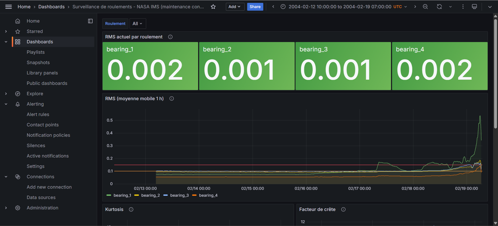
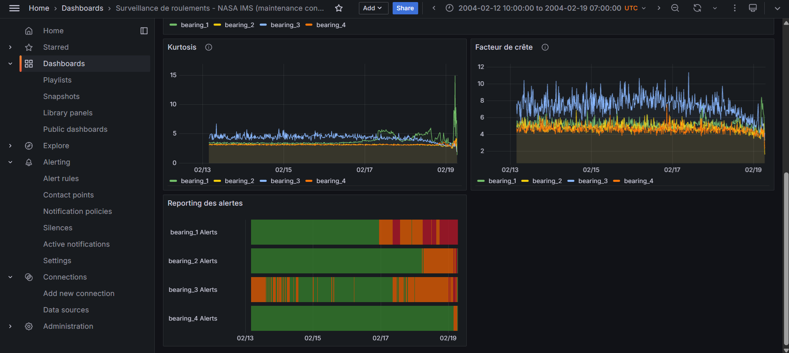
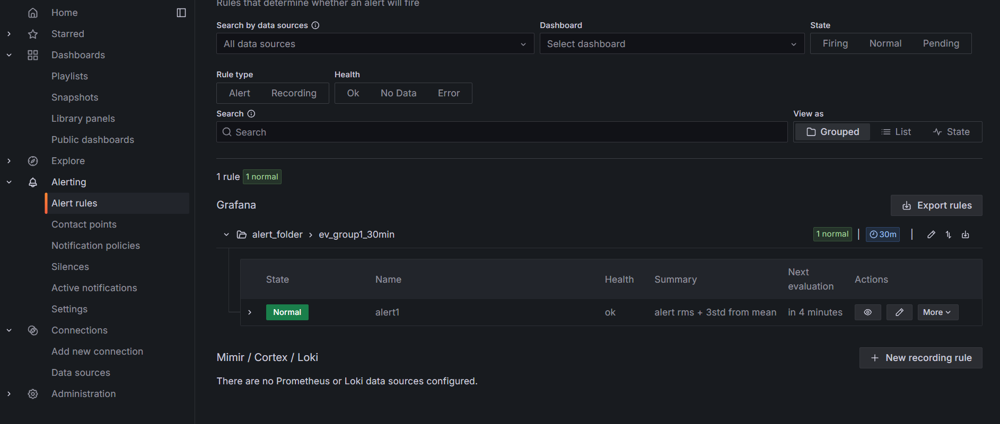

# Petit projet de simulation de monitoring utilisant un stack Docker, InfluxDB et grafana

Dashboard de maintenance conditionnelle construit sur le jeu de données public
NASA IMS Bearing,  exemple de suivi d'alerte en temps réel.

## Architecture

```
fichiers bruts IMS  ->  ingest.py (Python : RMS, kurtosis, crête, facteur de crête)
                    ->  InfluxDB 2.x (time series)  ->  Grafana (requêtes Flux, seuils, alertes)
```

## Lancer le projet

1. Télécharger le jeu de données NASA Prognostics Data Repository, « IMS Bearing Data Set »
   et placer le dossier `2nd_test` dans `data/`
   (les fichiers sont nommés `2004.02.12.10.32.39`, etc.).
2. Démarrer la stack :
   ```bash
   docker compose up -d
   ```

2. bis , si vous utilisez un env manager (as you should) tel que conda:
   ```powershell
   conda env create --name "env_demo_grafana" python=3.12
   ````


3. Installer les dépendances et ingérer les données :
   ```bash
   pip install -r requirements.txt
   python ingest.py --data-dir data/2nd_test
   ```
   (`--dry-run` affiche quelques points sans écrire dans InfluxDB.)
4. Ouvrir Grafana : http://localhost:3000 (admin / admin). Le datasource Flux et le
   dashboard « Surveillance de roulements » sont provisionnés automatiquement.
   

## Ce que montre le dashboard

- **RMS actuel** par roulement (stat avec seuils colorés).
- **RMS lissé (moyenne mobile 1 h)** : niveau global de vibration.
- **Kurtosis** : sensible aux impacts, réagit avant le RMS.
- **Facteur de crête** : détecte les chocs ponctuels.
- **Alert** : timeframes qui déclencheraient les seuils d'alertes


## Seuils et alerting

2 seuils d'alertes 0.10 et 0.15, une alerte est configurée sur une timeframe de 30 min quand les valeurs de RMS franchissent le seuil de 0.10 

## Screenshots :








